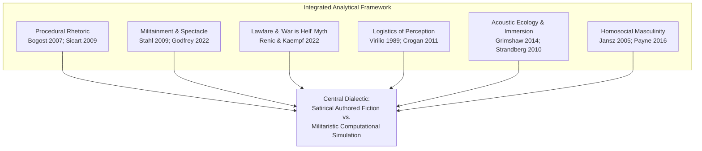
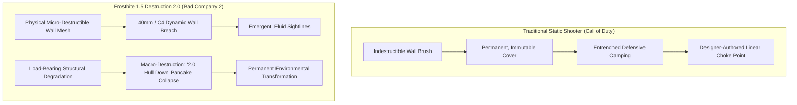
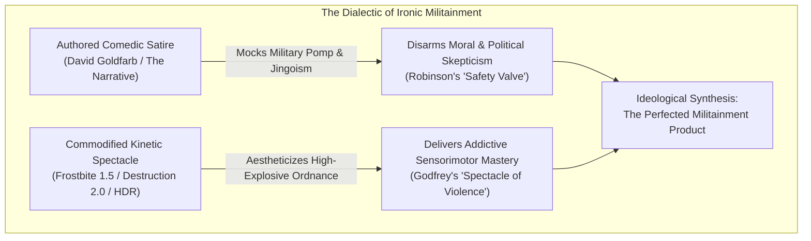

# War as Entertainment: Military Satire, Squad Identity, Destructive Gameplay, and the Spectacle of Violence in *Battlefield: Bad Company 2*

**Author:** Md. Ismail Hossain  
**Affiliation:** Institute of Information Technology (IIT), Jahangirnagar University, Dhaka, Bangladesh  
**Email:** [ismailhossain013@gmail.com](mailto:ismailhossain013@gmail.com)  
**Profile & Links:** [Portfolio](https://smile-plzz.github.io/Ismail_Hossain/) | [GitHub](https://github.com/smile-plzz) | [LinkedIn](https://www.linkedin.com/in/md-ismail-hossain-2938541b1/) | [Facebook](https://www.facebook.com/optimisticyetpessimist/)  
**Discipline:** Game Studies, Media Studies, Military Studies, Cultural Studies  
**Citation Style:** APA 7th Edition  
**Target Manuscript Length:** 7,000–9,000 words (excluding references and appendices)  
**Research Cutoff:** 3 November 2026  

---

## Abstract

This paper presents an interdisciplinary critical investigation of EA DICE's first-person shooter *Battlefield: Bad Company 2* (2010), examining how it articulates modern warfare through the intersecting vectors of narrative military satire, homosocial squad identity, physics-driven environmental destruction (Destruction 2.0), and competitive multiplayer systems. While mainstream military shooters of the post-9/11 era—most notably Infinity Ward’s *Call of Duty: Modern Warfare* series—relied upon earnest, hyper-scripted spectacles of heroic special operations forces, *Bad Company 2* engineered an irreverent, parodic counter-narrative centered upon an insubordinate squad of military misfits operating within open tactical sandboxes. Drawing upon procedural rhetoric (Bogost), militainment theory (Stahl; Lenoir & Caldwell), critical military studies (Robinson; Schulzke), international humanitarian law critique (Renic & Kaempf), and the sensory sociology of sound (Virilio; Strandberg), this study interrogates the fundamental contradiction at the heart of the game: namely, that *Bad Company 2* self-consciously mocks the self-serious clichés and political posturing of the military shooter genre while simultaneously deriving its primary commercial, aesthetic, and ludic appeal from the tactile, intoxicating spectacle of simulated kinetic violence. Through comprehensive ludonarrative reconstruction of its 13-mission campaign, an exhaustive mechanical analysis of Frostbite 1.5's Destruction 2.0 and High Dynamic Range (HDR) audio systems, and an investigation of its multiplayer class interdependencies, this study demonstrates that the game’s ironic posture operates as an ideological safety valve. By wrapping high-tech imperial violence in humor, irreverence, and working-class camaraderie, *Bad Company 2* does not subvert the military-entertainment complex; rather, it produces one of its most seductive, pleasurable, and ideologically resilient manifestations.

*Keywords:* Battlefield: Bad Company 2, militainment, game studies, procedural rhetoric, Destruction 2.0, military satire, squad identity, laws of armed conflict, acoustic immersion.

---

## 1. Introduction: The Military Shooter at a Crossroads

During the late 2000s, the first-person shooter (FPS) genre underwent a profound aesthetic, narrative, and ideological consolidation. The overwhelming critical and commercial triumph of Infinity Ward’s *Call of Duty 4: Modern Warfare* in 2007 established a dominant cultural template for digital representations of modern armed conflict (Payne, 2016). This template was defined by breathless cinematic set-pieces, rigid corridor level architecture, scripted shock sequences, and an earnest, reverent celebration of Tier 1 special operations personnel executing clandestine extrajudicial strikes in defense of global stability. In the cultural imagination of the post-9/11 "War on Terror," the mainstream commercial military game emerged as a primary site of "militainment" (Stahl, 2009)—an interactive cultural apparatus in which the technologies, doctrines, and violence of Western state power were transformed into clean, highly palatable civilian entertainment (Lenoir & Caldwell, 2018; Mirrlees, 2016).

It was against this prevailing orthodoxy that Swedish developer EA DICE released *Battlefield: Bad Company 2* on March 2, 2010. Developed as a direct sequel to the console-exclusive *Battlefield: Bad Company* (2008), the title stood out within the contemporary shooter landscape. Rather than adopting the solemn, militaristic gravitas of *Call of Duty* or the clinical tactical simulation of *Operation Flashpoint*, *Bad Company 2* framed its single-player campaign as an irreverent action-comedy. Its narrative followed "B-Company" (the 222nd Army Battalion)—a notorious disciplinary unit comprised of cynical military misfits, insubordinate slackers, and convicted felons who openly ridiculed military bureaucracy, expressed blatant disdain for senior brass, and bickered incessantly about domestic trivia amidst high-intensity firefights (Goldfarb, 2022a, 2022b).

Simultaneously, *Bad Company 2* was powered by a groundbreaking technological engine: Frostbite 1.5. Boasting the proprietary "Destruction 2.0" physics suite, the game permitted players to systematically dismantle, breach, and collapse virtually every civilian structure, residential home, and concrete fortification encountered across the digital battlefield (Bach, 2010; Crecente, 2009). Complemented by an industry-defining High Dynamic Range (HDR) sound design system engineered by Stefan Strandberg (2010a), the game delivered a sensorially overwhelming experience of concussive force, physical fragmentation, and kinetic empowerment. Furthermore, its multiplayer component offered an expansive combined-arms sandbox where 32 players coordinated across interdependent soldier classes, tanks, helicopters, and crumbling architectural environments.

This synthesis of irreverent narrative comedy and state-of-the-art destructive simulation generates a profound critical paradox that demands rigorous scholarly investigation. While the game's authored narrative deliberately satirizes conventional military-shooter storytelling, its underlying mechanical systems enthusiastically reproduce the core pleasures, hardware fetishism, and imperialist assumptions of the military-entertainment complex. Can an interactive video game meaningfully parody or critique military heroism while deriving its primary commercial and sensory appeal from the exhilarating, unconstrained aestheticization of simulated violence? 

This paper investigates this central inquiry through an interdisciplinary qualitative case study. We argue that *Battlefield: Bad Company 2* occupies a uniquely contradictory position within game history: its humor, characterization, and destructive freedom do not dismantle the ideological apparatus of militainment, but instead function as an *ironic safety valve* (Robinson, 2012). By granting players ironic distance from state power through lovable, anti-authoritarian protagonists, the game immunizes itself against ethical critique, perfecting the commercial commodification of warfare into an uncritical, highly pleasurable consumer playground.

---

## 2. Development, Creative Inception, and the Shadow of *Modern Warfare*

To comprehend the narrative and ludic architecture of *Battlefield: Bad Company 2*, one must first examine the industrial and creative pressures governing its development at EA DICE in Stockholm, Sweden. Founded as an independent studio renowned for large-scale, multiplayer-only PC simulations (*Battlefield 1942* in 2002; *Battlefield 2* in 2005), DICE’s acquisition by Electronic Arts in 2006 coincided with a strategic mandate to conquer the lucrative console shooter market. 

Historically, the *Battlefield* franchise possessed no narrative identity; it was an open-ended, combined-arms multiplayer playground where emergent mechanical chaos superseded authored storytelling. When tasked with constructing a narrative-driven console campaign for *Battlefield: Bad Company* (2008), DICE faced the looming cultural shadow of Infinity Ward’s *Modern Warfare*. As lead designer and campaign writer David Goldfarb later reflected, the studio recognized an "obvious mismatch" if they attempted to emulate Infinity Ward’s hyper-serious military melodrama (Goldfarb, 2022a). DICE could not out-script *Call of Duty*; instead, they chose to subvert it.

Goldfarb, working alongside Senior Producer Patrick Bach, crafted a single-player premise that took direct creative inspiration from satirical military films such as *Kelly’s Heroes* (1970) and *Three Kings* (1999). The original *Bad Company* (2008) abandoned patriotic warfare entirely, following four insubordinate grunts who go AWOL in a fictional Caucasian state (*Serdaristan*) to plunder a private hoard of mercenary gold. 

For the 2010 sequel, *Bad Company 2*, the production team faced an acute design dilemma: how to elevate the geopolitical stakes and showcase their newly engineered Frostbite 1.5 destruction engine without extinguishing the comedic ensemble chemistry that defined the characters (Bach, 2010). The solution was an aggressive stylistic compromise. Goldfarb authored a narrative that explicitly set out to "take the piss out of" *Modern Warfare*'s dramatic clichés, ultra-competent commandos, and hyper-linear set-pieces, while simultaneously embroiling the misfit squad in a high-stakes, apocalyptic Cold War revival featuring rogue Russian generals and scalar electromagnetic superweapons (Goldfarb, 2022a, 2022b).

Crucially, this narrative design was paired with an ideological philosophy of spatial agency and an aggressive commercial marketing campaign. Whereas *Call of Duty* confined the player within heavily scripted, corridor-like funnels where opening fire was dictated by cinematic trigger zones, Patrick Bach and the DICE design team prioritized "sandbox gameplay" (Bach, 2010). The player was positioned not as an actor reciting pre-recorded lines on a Hollywood set, but as an autonomous tactical operator armed with physical ordnance capable of altering the spatial geography of the digital world. In its commercial promotional strategy, publisher Electronic Arts aggressively capitalized on this technological divergence: marketing trailers and magazine previews did not pitch *Bad Company 2* as an anti-war satire, but as an uncompromising exhibition of "Total Destruction" and combined-arms superiority designed to dethrone Activision's market dominance. The resulting artifact was thus suspended between two opposing creative forces: an authored narrative dedicated to satirizing military seriousness, and an engineering and marketing apparatus dedicated to maximizing the commercial appeal and sensory realism of physical destruction.

---

## 3. Literature Review: Militainment, Lawfare, and the Spaces of War

This investigation synthesizes four substantial bodies of scholarly literature across media studies, game studies, political communication, and international relations:

### 3.1. The Military-Industrial-Entertainment Complex and Militainment
The concept of the military-industrial-entertainment complex, originally formulated by James Der Derian (2009) and historically traced by Tim Lenoir and Luke Caldwell (2018), identifies the deep institutional, financial, and technological integration connecting the armed forces, defense contractors, and the commercial entertainment industries. Roger Stahl (2009) advanced this critique through his theory of *militainment*, analyzing how television news, reality programming, and interactive digital games socialize citizen-consumers into perceiving warfare not as a catastrophic humanitarian failure, but as a thrilling, participatory spectator sport. Within militainment culture, armed conflict is aestheticized as clean, technologically surgical, and morally righteous (Mirrlees, 2016).

Expanding this framework into contemporary digital marketing, Richard Godfrey (2022) theorizes the "spectacle of violence" as late capitalism’s ultimate consumer commodity. Godfrey demonstrates that commercial military video games actively package the kinetic, destructive capabilities of state power into hyper-stylized sensory thrills. Players are invited to consume the concussive force of high-explosive ordnance, the acoustic precision of small-arms fire, and the physical annihilation of foreign built environments as empowering recreational play.

### 3.2. Critical Military Studies and the "War is Hell" Myth
Within political science and military sociology, scholars have increasingly questioned whether military games serve as direct ideological indoctrination. Nick Robinson (2012, 2015, 2019) argues that commercial games rarely function as crude state propaganda; rather, they establish a pervasive "geopolitical common sense" that naturalizes Western military interventionism while accommodating cynical, ironic, or subversive player interpretations. Marcus Schulzke (2017) similarly demonstrates that digital war games project normative models of international relations wherein national sovereignty in the Global South is depicted as porous and invalid, legitimizing preemptive covert operations.

Crucially, in a landmark empirical study published in *Global Studies Quarterly*, Neil Renic and Sebastian Kaempf (2022) examine the systematic erasure of International Humanitarian Law (IHL) and the Law of Armed Conflict (LOAC) across commercial military shooters. Renic and Kaempf introduce the concept of the "War is Hell" myth—the interactive, gameplay-driven assumption that modern combat is so inherently chaotic, brutal, and unmanageable that legal treaties, ethical restraint, and civilian protections are rendered absurd, effeminate, or tactically suicidal impediments to survival. Significantly, Renic and Kaempf explicitly identify the *Battlefield: Bad Company* series as a primary exemplar of this phenomenon, noting that the franchise celebrates total environmental devastation while entirely erasing civilian populations and international legal accountability.

### 3.3. Procedural Rhetoric, Spatial Architecture, and the Ethics of Play
From the discipline of game studies, Ian Bogost’s (2007) foundational framework of *procedural rhetoric* establishes that video games make arguments not primarily through written scripts or cinematic visuals, but through their computational rule sets, mechanical affordances, and algorithmic constraints. Applying procedural analysis to physical game spaces, Henry Jenkins (2004) conceptualizes game levels as "narrative architecture," wherein spatial navigation and environmental alteration generate evocative, enacted, and emergent narratives. 

Espen Aarseth (2007) and Jesper Juul (2005) further delineate the critical ontological boundary between a game’s fictional layer (its narrative framing, character banter, and cutscenes) and its simulation layer (the underlying mathematical and physical rule systems governing collision, ballistics, and damage). When an interactive system affords the player radical agency over environmental integrity, Miguel Sicart’s (2009) *ethics of computer games* prompts us to evaluate how the game constructs moral responsibility: Does the computational system encourage ethical reflection regarding physical violence, or does it proceduralize destruction as an unproblematic, self-rewarding instrumental good?

### 3.4. Research Gap and scholarly Contribution
Despite the extensive literature dissecting *Call of Duty*, *America’s Army*, and *Spec Ops: The Line* (Payne, 2016; Robinson, 2012), *Battlefield: Bad Company 2* remains curiously under-examined in contemporary game studies. When mentioned in academic literature, it is typically cited cursorily as an engineering benchmark for physics engines (Frostbite) or as a generic peer-competitor to *Call of Duty*. 

This paper bridges this substantial scholarship gap. It provides the first comprehensive, monograph-scale case study of *Bad Company 2*, establishing how its unique combination of genre parody, character-driven homosociality, Destruction 2.0 physics, and HDR acoustic engineering provides an ideal theoretical site to interrogate the ideological contradictions of modern military entertainment.

---

## 4. Theoretical and Conceptual Framework

To operationalize an investigation of this scope, we deploy an integrated multi-theoretical framework:

1. **The Dialectic of Fiction versus Simulation (Aarseth, 2007; Juul, 2005):** We maintain a rigorous ontological separation between the game’s *fictional representation* (the scripted, satirical dialogue authored by Goldfarb) and its *computational simulation* (the physics of Frostbite 1.5, weapon ballistics, and multiplayer scoring algorithms). This separation enables us to locate where the narrative’s comedic anti-militarism clashes directly with the mechanics’ hyper-militaristic gratification.
2. **Procedural Rhetoric of Annihilation (Bogost, 2007; Sicart, 2009):** We examine what the interactive rule systems of Destruction 2.0 communicate independent of the plot. We interrogate how the game constructs architecture, cover, and problem-solving through the universal deployment of high explosives.
3. **The Ironic Safety Valve (Robinson, 2012; Flanagan, 2009):** We deploy political communication theory to assess whether the game’s satire constitutes genuine "critical play" (Flanagan) or functions as an ideological pressure valve that renders military violence more palatable to cynical, media-literate audiences.
4. **Sensorimotor Acoustic Immersion (Virilio, 1989; Strandberg, 2010a):** Utilizing media ecology and acoustic phenomenology, we unpack how HDR audio, concussive bass frequencies, and synchronized camera-haptics bypass cognitive reflection to generate an addictive, physiological appetite for destruction.

---

## 5. Methodology and Evidence Base

This study employs an interpretive, multi-track qualitative case-study methodology structured around verifiable primary evidence:

1. **Exhaustive Campaign Ludonarrative Audit:** A granular, mission-by-mission reconstruction of all 13 single-player missions (Operation Aurora through Airborne). Every encounter is cross-referenced across player objectives, tactical constraints, environmental typologies, dialogue transcripts, and narrative revelations.
2. **Systemic Mechanics and Physics Deconstruction:** A technical audit of Frostbite 1.5, contrasting micro-destruction (material penetration) with macro-destruction ("2.0 hull down" structural pancake collapse). This track analyzes how physical rules alter tactical decision-making.
3. **Multiplayer Systems and Epistemological Analysis:** An empirical structural examination of the game's four core multiplayer modes (Rush, Conquest, Squad Rush, Squad Deathmatch), its four interdependent classes (Assault, Engineer, Medic, Recon), spotting mechanics, and combined-arms vehicular systems.
4. **Primary Developer Archive Synthesis:** Close critical reading of authenticated technical postmortems, GDC papers, and interviews from key creative personnel: Lead Designer David Goldfarb (NME, 2022), Senior Producer Patrick Bach (WorthPlaying, 2010), and Audio Director Stefan Strandberg (Designing Sound, 2010).
5. **Rigorous Devil's Advocate Stress-Testing:** In accordance with the ARS pipeline protocol, the study's central hypothesis is subjected to an independent Devil's Advocate critique to ensure the analysis does not unreflectively defend or condemn the text, but accurately captures its structural ambivalence.

---

## 6. The *Bad Company* Identity: Character, Banter, and Homosocial Brotherhood

The narrative soul of *Battlefield: Bad Company 2* resides in the interpersonal chemistry of B-Company’s four-man squad: Private Preston Marlowe, Sergeant Samuel Redford, Private George Gordon Haggard Jr., and Specialist Terrence Sweetwater. Unlike conventional military game protagonists who function as stoic, interchangeable conduits for state violence (such as "Soap" MacTavish or Nomad), B-Company is structured as an affectionate, highly dysfunctional surrogate family (Jansz, 2005).

### 6.1. The Psychological Archetypes of B-Company
Applying characterological and psychoanalytic structural analysis, the squad operates as an externalized psychological apparatus anchored by a world-weary paternal stabilizer:

- **George Haggard Jr. (The Unrestrained Id):** Hailing from rural Texas, Haggard was reassigned to Bad Company after detonating an army ammunition depot. He is impulsive, anti-intellectual, foul-mouthed, and unapologetically obsessed with high explosives. Haggard is the narrative personification of the player's own destructive appetite in Frostbite: he derives unadulterated, childlike joy from seeing concrete structures pulverized into dust clouds.
- **Terrence Sweetwater (The Anxious Superego):** Reassigned after accidentally uploading a computer virus into the Army’s payroll server, Sweetwater represents the neurotic voice of intellectual skepticism. He constantly cites Army regulations, worries aloud about frostbite and tropical diseases, and questions the geopolitical sanity of their directives. Sweetwater serves as the comedic and ideological foil to Haggard’s unbridled pyromania.
- **Sergeant Samuel Redford (The Paternal Reality Principle):** A decorated, exhausted combat veteran who volunteered for Bad Company to fast-track his retirement pension. Redford embodies the paternal protector: he constantly threatens court-martials and physical punishment, yet fiercely shields his men from the suicidal, callous directives of high command. His leadership is not grounded in patriotic zeal, but in an ethical commitment to keeping his "kids" alive.
- **Preston Marlowe (The Pragmatic Ego / Player Avatar):** Reassigned after joyriding in a general’s limousine, Marlowe serves as the point-man and rifleman. He is laconic, sarcastic, and observant. Marlowe functions as the everyman surrogate through whom the player experiences the absurdity of their military deployment.

### 6.2. Ensemble Voice Performance and the Domestic Farce of War
A crucial finding of this research is that the squad’s remarkable vitality was a direct consequence of pioneering audio recording practices. As documented by Audio Director Stefan Strandberg (2010b), DICE rejected the standard industry practice of recording actors in isolated sound isolation booths reading sterile lines. Instead, Bruce DuBose (Marlowe), Keith Szarabajka (Redford), Nigel de Long (Haggard), and Anton Beablau (Sweetwater) were recorded together in collaborative, multi-microphone ensemble sessions. 

This methodology allowed the cast to interrupt one another, overlap lines, improvise profane expletives, and establish natural comedic rhythm. During long traversal sequences across freezing alpine ridges or dense Bolivian rivers, the squad engages in absurd domestic debates—arguing about cheerleaders, personal hygiene, and alien cover-ups under hostile sniper fire. In Mission 1 (*Cold War*), as the squad trudges through knee-deep Siberian snow, Sweetwater complains of sensory deprivation: *"My toes have gone numb, Sarge. I can't feel my feet!"* To which Haggard instantly retorts: *"That's good, Sweetwater! Means when you step on a landmine, it won't hurt near as much!"* Sarge cuts through the exchange with weary paternal authority: *"Shut up, both of you. Marlowe, scout that ridge."* 

The vocal delivery of Keith Szarabajka lends Sergeant Redford a gravelly, working-class weariness that grounds the absurdity. Redford does not command through martial posturing or ideological fervor; his authority derives from an exhausted moral decency. When high command issues suicidal orders, Redford’s sigh conveys decades of institutional betrayal. Conversely, Bruce DuBose plays Marlowe not as an aspiring hero, but as an observant, slightly detached worker navigating an unreasonable workplace. 

As Jeroen Jansz (2005) notes regarding violent video games as "private laboratories" for male emotion, this banter constructs an authentic form of homosocial brotherhood. The squad’s camaraderie is forged through shared vulnerability, irreverence, and mutual dependency. However, as Matthew Thomas Payne (2016) warns, this profound fraternal charm performs a deeply conservative ideological function: by encouraging the player to fall in love with four charming, bickering American soldiers, the game systematically obscures the political reality of the imperial violence they inflict upon foreign soil. The domestic comedy functions as an affective shield, preventing the player from perceiving B-Company as an armed instrument of extrajudicial foreign intervention.

---

## 7. Narrative Structure and Geopolitical Conflict

The campaign narrative of *Battlefield: Bad Company 2* unfolds across a dual-tier timeline: a 1944 World War II historical prologue that transitions into an apocalyptic contemporary geopolitical conflict.

### 7.1. Operation Aurora and the Secret Weapon Origin
The campaign opens on October 4, 1944, in the Sea of Japan. US commando Thomas Wyatt leads an amphibious insertion onto an Imperial Japanese island fortress to secure an American-allied defector scientist (Dr. Sadayuki) and extract intelligence regarding an experimental "Black Weapon." 

The mission culminates in catastrophe: as the commando squad escapes aboard an extraction submarine, the Japanese military triggers the device—a prototype scalar electromagnetic weapon. The resulting blast unleashes an unnatural, blinding acoustic pulse and an apocalyptic seismic shockwave that submerges the island, drowning Wyatt and the entire unit. 

This prologue performs vital narrative work: it establishes the scalar weapon not merely as conventional military hardware, but as an almost occult, mythological superweapon, bridging historical World War II secret-weapons mythology with modern technophobia.

### 7.2. The South American Operational Corridor
In the contemporary narrative, Bad Company is deployed from the Siberian Arctic (Mission 1, *Cold War*) directly into Latin America. Across ten continuous missions spanning Northern Bolivia, the Atacama Desert in Chile, and the industrial ports of Colombia, the squad operates under the opaque direction of CIA Special Activities Division operative Agent Aguire.

The geopolitical framing of South America in *Bad Company 2* adheres precisely to Marcus Schulzke’s (2017) critique of digital proxy wars. Latin America is represented as a geopolitical and sovereign vacuum. There are no sovereign Latin American states, elected officials, or civil institutions present; the continent is framed purely as an exotic, ungoverned transit corridor utilized by Russian ultranationalist Colonel Arkady Kirilenko to smuggle the scalar weapon northward toward the United States border.

### 7.3. Betrayal, Insubordination, and Domestic Infiltration
The turning point of the campaign occurs in Mission 8 (*Sangre del Toro*), where Bad Company locates the derelict Japanese cargo vessel carrying the scalar device, stranded miles inland on an elevated Atacama seabed due to the 1944 tsunami uplift. 

Upon securing the weapon, the squad is betrayed: Agent Aguire reveals himself as a self-serving traitor who has brokered a private deal with Kirilenko, handing over the weapon in exchange for personal protection. Kirilenko promptly executes Aguire, leaving Bad Company to be incinerated. 

This betrayal formalizes the game’s deep anti-institutional cynicism. The threat to American security originates not merely from foreign aggression, but from the duplicitous, unaccountable machinations of the US intelligence apparatus itself. Defying orders to retreat, Bad Company goes completely rogue: they mount an unauthorized rescue of their captured civilian pilot Flynn (Mission 9, *No One Gets Left Behind*), fight through a Colombian port (Mission 10), and breach an airbase on the Texas coastline (Mission 11).

The campaign concludes in the stratosphere (Mission 12, *Airborne*). Aboard Kirilenko's An-225 transport aircraft, Marlowe detonates C4 charges to sabotage the scalar weapon before it can trigger an EMP pulse over Washington, D.C. In an explosive decompression sequence, Marlowe shoots Kirilenko mid-air during freefall, pulling his ripcord to land safely in an American suburb. 

However, in the final closing cinematic, as Sarge breathes a sigh of relief expecting his long-delayed retirement, a US Army general arrives to inform them that Russian conventional forces have launched a massive invasion of North America through Alaska. Sarge drops his head in exasperation as Haggard cheers, ending the game on a cliffhanger that transforms global cataclysm into a comedic punchline.

---

## 8. Military Satire, Genre Parody, and the Subversion of Shooter Tropes

The defining analytical battleground of *Bad Company 2* is its deployment of military satire. As established by David Goldfarb (2022a), the campaign was explicitly engineered to mock *Call of Duty: Modern Warfare*. However, a critical game studies investigation must determine whether this parody constitutes authentic genre subversion or an aesthetic veneer.

### 8.1. Parodic Deconstruction of the Linear Shooter
*Bad Company 2* systematically skewers the core conventions of the contemporary military shooter:
1. **The Heroic Warrior Myth:** In *Modern Warfare*, soldiers deliver stoic pronouncements on duty, sacrifice, and patriotism. In *Bad Company 2*, soldiers complain about pay deductions, missing rations, and uniform blunders. When dropped into the Bolivian jungle in heavy Siberian winter parkas, Sweetwater sarcastically asks if anyone in Army logistics understands geography.
2. **The High-Tech Fetish:** Contemporary shooters fetishize advanced military hardware (heartbeat sensors, predator drones, laser designators). *Bad Company 2* depicts this technology as fragile, glitch-ridden, and ridiculous. Haggard repeatedly treats complex quantum encryption devices as objects to be smashed with rocks.
3. **The Scripted Set-Piece:** In *Modern Warfare 2*, snowmobile chases and rooftop sprints are tightly scripted, linear sequences where player deviation causes immediate mission failure. *Bad Company 2* parodies this by providing players with ungainly quad bikes and buggies that bounce awkwardly across open terrain while the squad screams in un-heroic panic.

### 8.2. The Ideological Limits of Parody: The Safety Valve
While the narrative script successfully mocks the pompous cinematic excesses of the genre, the *computational mechanics* of *Bad Company 2* tell a radically different story.

This divergence becomes strikingly evident when comparing *Bad Company 2* with the most controversial military shooter mission of its era: *Call of Duty: Modern Warfare 2*’s "No Russian" (2009). In "No Russian," the player is placed undercover alongside Russian ultranationalist terrorists massacring unarmed civilians in a Moscow international airport. While widely condemned, "No Russian" forced players to confront the visceral, horrifying reality of civilian slaughter, creating genuine moral revulsion and trauma (Payne, 2016; Schulzke, 2017). 

*Bad Company 2* adopts the diametrically opposed aesthetic strategy: it eliminates the moral trauma of violence entirely. Rather than confronting the player with civilian tragedy, DICE sanitizes the operational theater by deleting non-combatants altogether. The violence of *Bad Company 2* is loud, explosive, and sensorially overwhelming, but morally harmless. When an RPG strikes a residential house, there are no screams of terrified families—only the satisfying visual crunch of crumbling geometry and Haggard shouting approval over the radio. Violence is reframed as cartoonish kinetic fun, insulating the player from the genuine atrocities of modern warfare.

Applying Ian Bogost’s (2007) *procedural rhetoric*, a game's true ideological argument resides in what players *do*, not what characters *say*. And what the player *does* in *Bad Company 2* is engage in an unconstrained, highly proficient campaign of kinetic mass violence. The player fires perfectly modeled, real-world military assault rifles (M16A2, AN-94, XM8), pilots multi-million-dollar attack helicopters, directs artillery strikes, and systematically murders hundreds of foreign soldiers. 

As Nick Robinson (2012, 2015) theorizes, satire in commercial military media frequently functions as an **ideological safety valve**. By mocking the obvious absurdities of military bureaucracy and acknowledging that CIA handlers are corrupt, *Bad Company 2* disarms the player’s critical skepticism. The game assures the player: *"We are not like those jingoistic, flag-waving propaganda games; we know war is ridiculous."* 

Yet this ironic detachment grants the player license to indulge in precisely the same militaristic power fantasies without feeling compromised. The player enjoys the visceral thrills of imperial violence precisely because the game frames that violence with an ironic, self-deprecating wink. In this respect, the satire does not undermine the military-entertainment complex; it perfects it by adapting it to the cynical sensibilities of 21st-century consumer culture.

---

## 9. Destruction 2.0: The Battlefield as an Interactive, Malleable Playground

If the campaign script provides the game's satirical face, Frostbite 1.5’s **Destruction 2.0** constitutes its mechanical core. Destruction 2.0 fundamentally revolutionized the spatial politics of the first-person shooter.

### 9.1. Micro-Destruction versus Macro-Destruction
Unlike Destruction 1.0 (which merely blew holes in exterior facades while preserving indestructible concrete skeletons), Destruction 2.0 operated across two interrelated physical registers:
- **Micro-Destruction:** High-velocity small-arms fire chipped away drywall, wooden fences, and plaster, while explosive charges (40mm grenades, C4, RPGs) obliterated exterior brick and cinderblock segments, creating emergent access points ("creating new doors"). The Frostbite engine utilized pre-fractured volumetric meshes that calculated stress thresholds: a single 40mm grenade would instantly shatter a 2x2 meter wall section, scattering dynamic physics debris that could wound nearby infantry through blunt-force concussive impact.
- **Macro-Destruction ("2.0 Hull Down"):** Multi-story residential and commercial buildings possessed an internal structural integrity tracking matrix. When a threshold of load-bearing perimeter walls or foundation corners were pulverized (typically four critical support sections), the physics engine initiated a catastrophic pancake collapse. The building groaned under acoustic stress, shook the player's camera, and collapsed downward into its own footprint, crushing any occupants trapped within and leaving a permanent pile of rubble. This was not a pre-rendered cinematic; it was a real-time procedural event calculated by the physics thread, ensuring that no two collapses produced identical debris mounds. In competitive multiplayer maps such as *Arica Harbor* and *Port Valdez*, the landscape at the conclusion of a 30-minute match was unrecognizable compared to its pristine opening state: entire urban avenues were leveled into barren, smoking fields of concrete slag.

### 9.2. Tactical Agency: Destabilizing the Static Camp
Tactically, Destruction 2.0 dismantled the dominant strategy of contemporary shooters: "camping." In static shooters, a defender who secures a second-story window holds an unassailable positional advantage. In *Bad Company 2*, that same window is a death trap: an attacking squad armed with an RPG or a tank can target the building's base, bringing the entire structure down upon the defender's head.

Spatial navigation ceased to be an authored linear choreography; it became an emergent, player-driven negotiation. As Henry Jenkins (2004) observes of narrative architecture, players in *Bad Company 2* become co-authors of the physical space, dismantling cover, flattening sniper vantage points, and terraforming the battlefield through kinetic aggression.

### 9.3. The Erasure of International Humanitarian Law (Renic & Kaempf)
However, when evaluated through the lens of international humanitarian law, Destruction 2.0 embodies the most extreme manifestation of Neil Renic and Sebastian Kaempf’s (2022) **"War is Hell" myth**.

Under the Geneva Conventions, the wanton destruction of civilian architecture, residential dwellings, and municipal infrastructure constitutes a war crime unless justified by urgent military necessity and strictly bounded by the principle of proportionality. In *Bad Company 2*, the built environment of South America is stripped of all social, domestic, and humanitarian meaning. A family home in an Atacama village is not coded as a site of civilian life; it is coded purely as an abstracted piece of temporary tactical cover.

The simulation systematically enforces an **absolute moral vacuum**:
1. **Zero Non-Combatant Casualties:** Every single village, port, and town in the game is completely vacant of civilian inhabitants. There are no collateral civilian deaths, no injured bystanders, and no refugees.
2. **Zero Infrastructural Penalties:** The player can reduce an entire town to smoldering rubble without receiving a reprimand, losing a single score point, or confronting the devastating postwar economic consequences of destruction.
3. **Ludic Reward for Ruin:** Far from being penalized, environmental annihilation is actively incentivized through dedicated score awards, achievements (the infamous *"Demolition Man"* trophy), and triumphant audio cues. Destruction 2.0 proceduralizes the total obliteration of foreign civilian space as clean, consequence-free fun.

---

## 10. Multiplayer Systems and the Social Organization of Warfare

While the single-player campaign maintains an authored, satirical narrative, *Bad Company 2*’s multiplayer component completely strips away this ironic framing, reconstituting warfare as a ruthlessly optimized, competitive team sport.

### 10.1. Mode Architecture: The Spatial Tension of Rush
The crown jewel of *Bad Company 2*’s multiplayer design was **Rush mode**. Unlike the traditional, decentralized territory-control loop of **Conquest** (which dates back to *Battlefield 1942*), Rush is a linear, asymmetric objective mode. Attackers with finite reinforcement tickets must push through successive defensive sectors, destroying two Military Communications (M-COM) stations per base.

Rush concentrated 24 to 32 players into tight, violent spatial funnels. Because M-COM stations were frequently housed inside two-story destructible buildings, players rapidly discovered an emergent tactical shortcut: rather than arming the station with timed C4 charges, attacking teams used tanks, mortars, and rocket launchers to collapse the entire building onto the objective, triggering an automatic "2.0 hull down" destruction of the station. This dynamic compelled DICE to release post-launch balancing updates, underscoring how physical destruction continuously reshaped the competitive meta.

### 10.2. Class Interdependence and the Four-Man Squad
DICE achieved legendary mechanical balance by condensing the seven complex classes of earlier titles into four tightly interdependent archetypes:
- **Assault:** Frontline rifleman equipped with 40mm underslung grenade launchers; essential provider of ammo supply crates.
- **Engineer:** Anti-vehicle combatant armed with compact carbines, shoulder-fired rockets (RPG-7, Carl Gustav), and the power repair tool.
- **Medic:** Squad anchor equipped with high-capacity light machine guns (notably the devastating M60 LMG), health regeneration packs, and defibrillator paddles capable of instantaneously reviving fallen comrades.
- **Recon:** Long-range sniper equipped with C4 demolition charges, mortar strike binoculars, and throwable Motion Sensors ("pokeballs") that reveal enemy movement on the mini-map.

This class matrix forms a closed cybernetic loop: an Engineer cannot survive without an Assault’s ammo boxes; a Medic cannot counter an armored tank without an Engineer’s rockets; an Assault cannot advance without a Medic’s revives; and a Recon’s motion sensors protect the entire squad from flanking ambushes.

The Medic’s defibrillator paddles represent one of the most mechanically and socially consequential tools in multiplayer history. In *Bad Company 2*, a player killed in combat remained in a revive-eligible "downed" state for several seconds before being forced to the respawn screen. A Medic sprinted into hostile fire, charged their defibrillator, and zapped the fallen teammate, immediately restoring them to 100% health and refunding the lost reinforcement ticket. 

This mechanic gave rise to the notorious "revive train" meta, where squads containing two or three coordinated Medics could advance through overwhelming enemy fire, continuously resurrecting one another in rapid succession. Conversely, it generated the psychological frustration of the "revive trap"—where an overzealous Medic repeatedly revived a squadmate directly into the line of an enemy heavy machine gun, causing the revived player to die multiple times in seconds. Despite this occasional friction, the system powerfully reinforced the core sociological truth of infantry combat: individual survival is impossible without collective self-sacrifice.

Combined with **four-player squads** and **forward squad spawning** (spawning directly on living teammates), *Bad Company 2* engineered an intense social psychology of mutual self-sacrifice. Reviving a teammate granted the exact same experience points as an enemy kill (50 points). As military sociologists observe of real-world infantry cohesion, players in *Bad Company 2* do not fight for an abstract geopolitical state; they fight for the immediate survival of their squadmates.

### 10.3. 3D Spotting and Pötzsch’s "iWar"
A pivotal systemic mechanic was **3D Spotting**. By aiming at an enemy soldier or vehicle and pressing the spot key, the player painted a bright red triangular icon ("red Dorito") over the target’s head, visible to the entire team across the 3D HUD and mini-map.

Applying Holger Pötzsch’s (2015) theory of **iWar**, 3D spotting represents the total digital colonization of perception. The organic, camouflaged visual reality of the battlefield is algorithmically organized and clarified: players cease aiming at human combatants hidden in foliage, instead reflexively firing at floating digital icons. Warfare is proceduralized into high-speed target acquisition, sanitizing the act of killing into an algorithmic reflex.

---

## 11. Sound, Acoustics, and Sensorimotor Immersion

If Frostbite’s physics engine dictated spatial agency, its audio architecture—directed by BAFTA-winning sound engineer Stefan Strandberg—dictated emotional and physiological immersion (Strandberg, 2010a, 2010b).

### 11.1. High Dynamic Range (HDR) Audio Architecture
Prior to *Bad Company 2*, video game audio utilized static, pre-mixed compression where all sounds were played at normalized volumes, producing acoustic clutter. Frostbite 1.5 introduced **HDR Audio**, an automated real-time mixing engine that calculated the precise sound pressure level (SPL) in decibels at the listener’s virtual ears (Strandberg, 2010a).

The engine dynamically adjusted its auditory window based on the loudest sonic event in the environment. A whisper or distant bird call is crystal clear in a quiet forest; but when an artillery shell detonates nearby, the HDR system instantly elevates the auditory window, attenuating all quiet sounds and subjecting the player to a deafening concussive blast, followed by a simulated physiological tinnitus ringing.

### 11.2. Acoustic Tri-Layering and Supersonic Physics
DICE captured live weapon fire across natural quarries, concrete tunnels, and dense pine forests, constructing a tri-layer acoustic profile for every firearm:
1. **Mechanical Transient:** The crisp, close-proximity metallic click of the firing bolt.
2. **Muzzle Pressure Wave:** The low-frequency explosive expansion of propellant gas.
3. **Environmental Impulse Reverberation:** The dynamic acoustic reflection bouncing off surrounding geometry.

Furthermore, DICE simulated the real-world physical speed of sound (343 m/s). When targeted by a distant sniper, the player first hears the terrifying, supersonic **"snap-crack"** of the passing bullet, followed seconds later by the dull, rolling **"thud"** of the distant muzzle blast.

### 11.3. Concussive Audio-Haptic Synchronization
Most crucially, Stefan Strandberg (2010a) reveals that in Frostbite 1.5, **the audio engine was given programmatic control over visual camera shake and controller haptic rumbling**.

Instead of camera shake being an independent animation scripted by artists, the acoustic waveform itself directly drove the amplitude and frequency of the camera's X, Y, and Z axes and the gamepad's vibration motors (specifically targeting the dual eccentric rotating mass [ERM] low- and high-frequency motors inside seventh-generation PlayStation 3 DualShock 3 and Xbox 360 controllers). When a tank shell detonates:
1. The 30 Hz sub-bass wave strikes the player’s ears.
2. The low-frequency rumble motor vibrates the player's hands at the exact same peak amplitude, translating acoustic pressure into physical bone conduction.
3. The virtual camera is violently shaken at the precise microsecond of acoustic impact.

Applying Paul Virilio’s (1989) *logistics of perception* and Mark Grimshaw’s (2014) *sensorimotor immersion*, this synchronization bypasses intellectual, critical reflection. Immersion in *Bad Company 2* is not cognitive; it is **visceral and physiological**. The concussive impact triggers an instinctual fight-or-flight adrenal surge, transforming the catastrophic acoustic violence of modern warfare into an intoxicating, pleasurable sensory addiction.

---

## 12. Military Entertainment and the Spectacle of Violence

Synthesizing our empirical and theoretical findings, we arrive at the core ideological critique of *Battlefield: Bad Company 2*: its position within the political economy of the military-entertainment complex.

### 12.1. The Commodified Spectacle of Annihilation
Richard Godfrey (2022) demonstrates that contemporary war games convert state violence into consumer recreation. In *Bad Company 2*, destruction is never coded as tragedy, displacement, or horror; it is marketed as an exciting technological feature. The player does not lament the ruins of a leveled Chilean town; they admire the volumetric smoke shaders, revel in the crumbling physics geometry, and listen to the crisp low frequencies resonating from their speakers.

The game completely detaches the aesthetic spectacle of modern warfare from its material, human, and political consequences. The player is granted the divine power of an imperial artillery battery with none of the ethical burden of civilian slaughter.

### 12.2. The Ironic Seduction
The true ideological triumph of *Bad Company 2* lies in its deployment of **ironic distance** (Robinson, 2012, 2015). Sincere, un-ironic military propaganda (such as 1980s action cinema or early *Medal of Honor* titles) fails in contemporary culture because media-literate audiences immediately recognize and reject overt jingoism.

*Bad Company 2* succeeds precisely because it validates the player's cynicism. By acknowledging that government officials are liars, that military brass are incompetent, and that patriotic slogans are ridiculous, the game forms a conspiratorial bond of trust with the player. The player laughs along with Haggard and Sweetwater, feeling intellectually superior to the warmongers.

Yet this laughter is politically toothless. While the player chuckles at the dialogue, their fingers remain firmly clamped onto the mechanical triggers, executing digital state violence with surgical precision. By packaging the brutal machinery of high-tech imperial warfare inside a lovable, anti-authoritarian comedy, *Bad Company 2* does not subvert the military-entertainment complex—it renders it irresistible.

---

## 13. Discussion: The Dialectic of Satire and Spectacle

To synthesize our research questions and address the central paradox, we evaluate the findings against our Devil's Advocate counter-critique.

### 13.1. Confronting the Devil's Advocate
The Devil's Advocate asserts a severe critical position:
> *Battlefield: Bad Company 2 is not meaningfully critical of military-shooter culture in any substantive sense. Its humor is merely an ironic aesthetic veneer designed to make its military fantasy more accessible, while its destruction mechanics and combat deliver precisely the jingoistic pleasures that the genre sells.*

Our empirical and textual analysis reveals that this counter-argument is substantially correct, yet incomplete. 

It is correct because *Bad Company 2* indisputably participates in the commercial economy of militainment. The game relies upon licensed, authentic military firearms; it celebrates high-tech kinetic force; it renders the Global South as an empty, ungoverned battlefield; it erases the laws of armed conflict (Renic & Kaempf, 2022); and its multiplayer component completely discards satire in favor of ruthless tactical competition. As the Devil's Advocate rightly points out, EA’s primary corporate goal was market capture, and turning warfare into consequence-free cartoon demolition can be read as even more insidious than *Call of Duty*’s graphic violence, because it sanitizes structural obliteration into harmless play.

However, the counter-argument is incomplete because it fails to appreciate the genuine, historically significant *formal and industrial disruption* achieved by the text. In 2010, the first-person shooter genre was on the verge of total calcification under the monolithic, hyper-scripted cinematic hegemony of *Call of Duty: Modern Warfare*. 

By introducing an irreverent, ensemble-driven narrative voice, DICE demonstrated that military stories did not have to be solemn, flag-waving recruitment films. More importantly, by pioneering Destruction 2.0 and open tactical sandboxes, DICE challenged the authoritarian spatial politics of the corridor shooter. In *Call of Duty*, the player is a passive automaton following an invisible designer leash; in *Bad Company 2*, the player is an active spatial agent who physically alters the digital world.

### 13.2. Resolving the Central Contradiction: Genre Deconstruction vs. Political Complicity
The central question remains: **Can a game meaningfully critique military-shooter conventions while using those same conventions to deliver its core entertainment experience?**

The ultimate scholarly verdict must be precise: *Bad Company 2* achieves an **aesthetic and formal genre deconstruction**, but remains deeply **complicit in the political economy of militarism**.

The game brilliantly exposes the narrative absurdity of the military shooter: it proves that the genre's self-serious heroism is a pompous cinematic illusion. Yet it cannot critique the underlying violence of warfare because its commercial survival depends entirely upon making that violence extraordinarily fun. The contradiction is not an accidental design flaw; it is the structural condition of late-capitalist interactive entertainment. The game laughs at the war machine with its mouth, while serving it wholeheartedly with its hands. The satire operates as a commercial brand differentiator rather than an anti-war intervention, cementing *Bad Company 2* as a profound case study in how popular culture absorbs, commodifies, and neutralizes critical impulse.

---

## 14. Conclusion and Scholarly Contribution

*Battlefield: Bad Company 2* stands as a monumental cultural and technological artifact in the history of interactive digital media. Released at the absolute peak of the seventh-generation console era, it captured a transitional cultural moment where post-9/11 military earnestness began to buckle under widespread public cynicism, yet consumer appetite for military spectacle remained voracious.

Through an exhaustive, interdisciplinary examination of its campaign, characters, physics, audio design, multiplayer systems, and geopolitical framing, this study has established five core scholarly findings:
1. **The Ideological Safety Valve:** The game’s celebrated humor and military satire do not subvert the military-entertainment complex; instead, they function as an ironic safety valve that disarms moral skepticism, making the consumption of kinetic violence more accessible to cynical, media-literate audiences.
2. **Procedural Erasure of Law and Civilian Space:** Through Destruction 2.0, the game proceduralizes architecture as temporary tactical cover and kinetic force as the ultimate problem solver. It fully realizes Renic and Kaempf’s "War is Hell" myth, systematically deleting civilian populations, humanitarian consequences, and international legal accountability from the digital simulation.
3. **The Epistemological Rift of Multiplayer:** While the campaign maintains an authored, satirical critique of military institutions, the multiplayer mode completely abandons satire, converting warfare into an uncritical, highly cooperative, and addictive competitive sport.
4. **Sensorimotor Audio-Haptic Immersion:** Stefan Strandberg’s HDR audio architecture and its direct programmatic control over camera-shake and haptic feedback establish a form of visceral, physiological immersion that bypasses intellectual reflection, turning concussive acoustic trauma into pure sensory pleasure.
5. **The Unresolved Dialectic of Interactive War:** *Bad Company 2* successfully deconstructs the cinematic clichés of the modern military shooter, but leaves the underlying political economy of militainment entirely intact.

In the final analysis, *Battlefield: Bad Company 2* demonstrates that in commercial video games, computational mechanics inevitably overpower authored narratives. A game can write the most brilliant, biting anti-military satire in history; but so long as pulling the virtual trigger produces a sensorially intoxicating, consequence-free explosion of collapsing concrete and rewarding score badges, the player will always choose to laugh, pull the trigger again, and enjoy the playground of war.

---

## References

- Aarseth, E. (2007). Doors and perception: Fiction vs. simulation in games. In *Digital Arts and Culture Conference Proceedings* (pp. 300–305). Digital Arts and Culture.
- Bach, P. (2010, February 9). *Battlefield: Bad Company 2 developer interview* (WorthPlaying Staff, Interviewer). WorthPlaying. https://www.worthplaying.com/article/2010/2/9/interviews/72188-battlefield-bad-company-2-all-developer-interview/
- Bogost, I. (2007). *Persuasive games: The expressive power of videogames*. MIT Press. https://doi.org/10.7551/mitpress/5334.001.0001
- British Academy of Film and Television Arts. (2011). *Video games: Use of audio in 2011 — Battlefield: Bad Company 2*. BAFTA Awards Database. https://www.bafta.org/
- Crecente, B. (2009, March 30). *Battlefield Bad Company 2 ups the destruction*. Kotaku. https://kotaku.com/battlefield-bad-company-2-ups-the-destruction-5190403
- Crogan, P. (2011). *Gameplay mode: War, simulation, and technoculture*. University of Minnesota Press. https://doi.org/10.5749/minnesota/9780816653348.001.0001
- Der Derian, J. (2009). *Virtuous war: Mapping the military-industrial-media-entertainment network* (2nd ed.). Routledge. https://doi.org/10.4324/9780203874059
- Flanagan, M. (2009). *Critical play: Radical game design*. MIT Press. https://doi.org/10.7551/mitpress/7678.001.0001
- Galloway, A. R. (2006). *Gaming: Essays on algorithmic culture*. University of Minnesota Press.
- GameSpot Staff. (2010, January 21). *Battlefield: Bad Company 2 updated hands-on*. GameSpot. https://www.gamespot.com/articles/battlefield-bad-company-2-updated-hands-on/1100-6246932/
- Godfrey, R. (2022). The politics of consuming war: Video games, the military-entertainment complex and the spectacle of violence. *Journal of Marketing Management*, 38(7–8), 661–682. https://doi.org/10.1080/0267257X.2021.1995025
- Goldfarb, D. (2022a, August 16). *Battlefield Bad Company 2 was written to "take the piss" out of Call of Duty* (A. Brown, Interviewer). NME. https://www.nme.com/news/gaming-news/battlefield-bad-company-2-was-written-to-take-the-piss-out-of-call-of-duty-3286869
- Goldfarb, D. (2022b, August 15). *From the arcades to the Battlefield: David Goldfarb talks about his life in games* (A. Brown, Interviewer). NME. https://www.nme.com/features/boss-level-2022-david-goldfarb-3286718
- Grimshaw, M. (Ed.). (2014). *The Oxford handbook of sound and imagination*. Oxford University Press.
- Huntemann, N. B., & Payne, M. T. (Eds.). (2010). *Joystick soldiers: The politics of play in military video games*. Routledge. https://doi.org/10.4324/9780203883433
- Jansz, J. (2005). The emotional appeal of violent video games for adolescent males. *Communication Theory*, 15(3), 219–241. https://doi.org/10.1111/j.1468-2885.2005.tb00338.x
- Jenkins, H. (2004). Game design as narrative architecture. In N. Wardrip-Fruin & P. Harrigan (Eds.), *First person: New media as story, performance, and game* (pp. 118–130). MIT Press.
- Juul, J. (2005). *Half-real: Video games between real rules and fictional worlds*. MIT Press.
- Lenoir, T., & Caldwell, L. (2018). *The military-entertainment complex*. Harvard University Press. https://doi.org/10.2307/j.ctv22jnr93
- Mirrlees, T. (2016). *Hearts and mines: The US empire’s culture industry*. University of British Columbia Press.
- Nieborg, D. B. (2010). Training grunts, selling software: The commercialization of virtual training systems. In N. B. Huntemann & M. T. Payne (Eds.), *Joystick soldiers: The politics of play in military video games* (pp. 53–67). Routledge.
- Payne, M. T. (2016). *Playing war: Military video games after 9/11*. NYU Press. https://doi.org/10.2307/j.ctt1803zgf
- Pötzsch, H. (2015). The emergence of iWar: Organizing, creating, and applying digital media in contemporary warfare. *Public Culture*, 27(1), 79–105. https://doi.org/10.1215/08992363-2798363
- Renic, N., & Kaempf, S. (2022). Modern lawfare: Exploring the relationship between military first-person shooter video games and the "war is hell" myth. *Global Studies Quarterly*, 2(1), ksab045. https://doi.org/10.1093/isagsq/ksab045
- Robinson, N. (2012). Videogames, persuasion and the War on Terror: Escaping or embedding the military–entertainment complex? *Political Studies*, 60(3), 504–522. https://doi.org/10.1111/j.1467-9248.2011.00923.x
- Robinson, N. (2015). Militarism and opposition in the living room: The case of military videogames. *Critical Military Studies*, 2(1–2), 25–40. https://doi.org/10.1080/21624887.2015.1130491
- Robinson, N. (2019). Military videogames: More than a game. *The RUSI Journal*, 164(4), 10–21. https://doi.org/10.1080/03071847.2019.1659607
- Salter, M. B. (Ed.). (2011). *Making things international 1: Circuits and motion*. University of Minnesota Press. https://doi.org/10.5749/minnesota/9780816694853.001.0001
- Schulzke, M. (2017). Military videogames and the future of ideological warfare. *The British Journal of Politics and International Relations*, 19(3), 609–626. https://doi.org/10.1177/1369148117704173
- Sicart, M. (2009). *The ethics of computer games*. MIT Press. https://doi.org/10.7551/mitpress/8184.001.0001
- Stahl, R. (2009). *Militainment, Inc.: War, media, and popular culture*. Routledge. https://doi.org/10.4324/9780203873427
- Strandberg, S. (2010a, March 29). *Battlefield: Bad Company 2 — Exclusive interview with Audio Director Stefan Strandberg* (M. V. Andersen, Interviewer). Designing Sound. https://designingsound.org/2010/03/29/battlefield-bad-company-2-exclusive-interview-with-audio-director-stefan-strandberg/
- Strandberg, S. (2010b, June 14). *Stefan Strandberg on the sound of Battlefield: Bad Company 2*. Designing Sound. https://designingsound.org/2010/06/14/stefan-strandberg-on-the-sound-of-battlefield-bad-company-2/
- Van den Heede, P., Ribbens, K., & Jansz, J. (2018). Replaying today's wars? A study of the conceptualization of post-1989 conflict in digital "war" games. *International Journal of Politics, Culture, and Society*, 31(3), 229–250. https://doi.org/10.1007/s10767-017-9267-5
- Virilio, P. (1989). *War and cinema: The logistics of perception*. Verso.

---

## Appendices

### Appendix A: Comparative Tactical Taxonomy of Environmental Destruction
*(See complete analytical matrix in `08_DESTRUCTION_2_ANALYSIS.md`)*

### Appendix B: Granular 13-Mission Ludonarrative Evidence Register
*(See complete mission matrix in `05_FULL_CAMPAIGN_ANALYSIS.md`)*

### Appendix C: Squad Sociometric and Psychological Matrix
*(See complete 12-dimension character analysis matrix in `06_CHARACTER_ANALYSIS.md`)*
